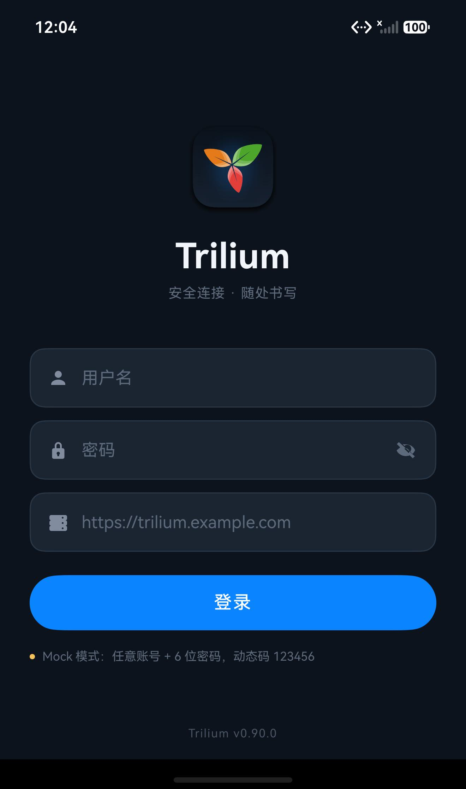
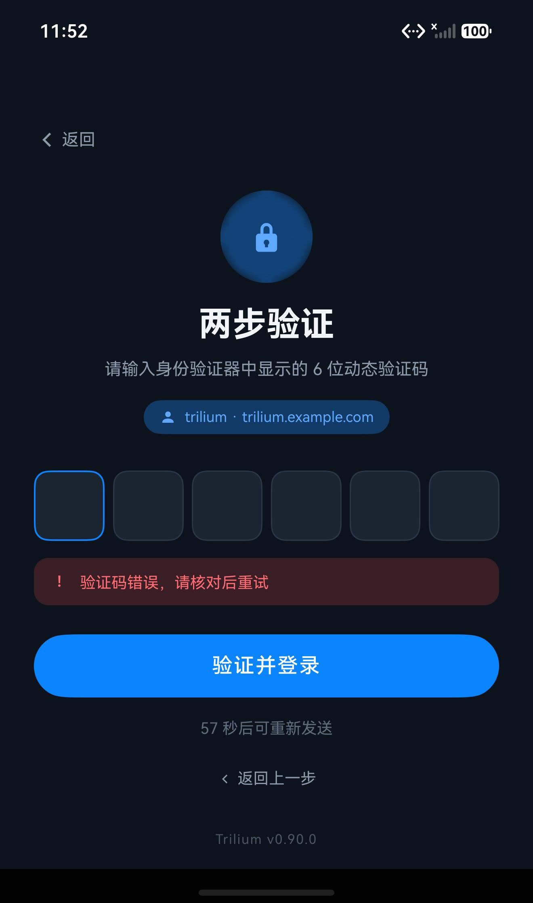
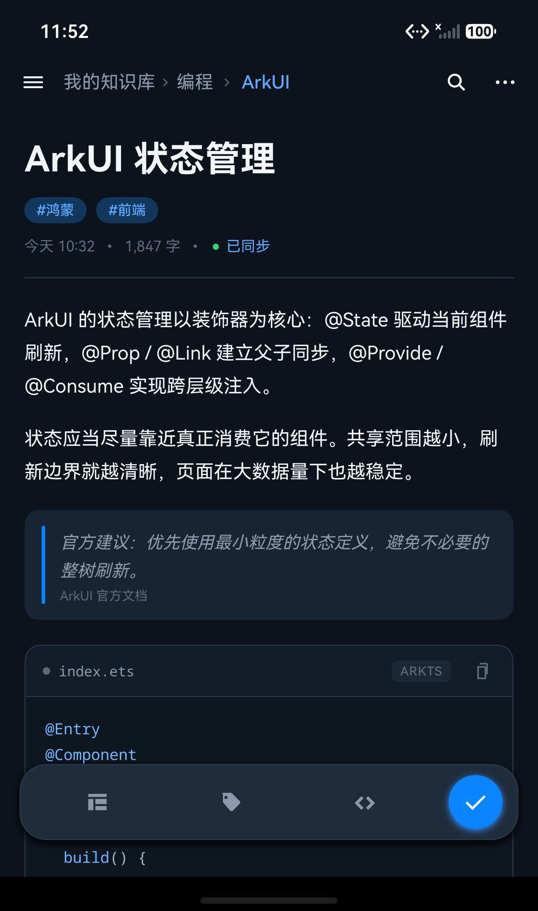
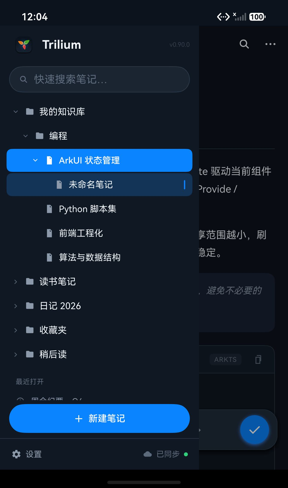
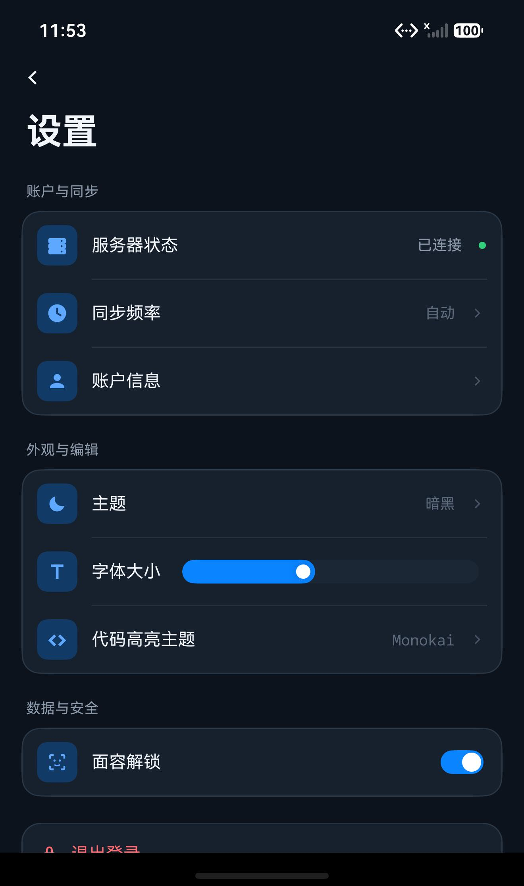
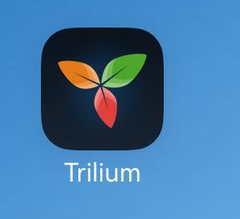

# Trilium HarmonyOS

[](https://www.harmonyos.com/)
[](https://developer.huawei.com/consumer/cn/arkts/)
[](#)
[](https://www.gnu.org/licenses/agpl-3.0)

> **License**：本项目基于 **GNU AGPL-3.0** 开源。
>
> **获取完整源码**：<https://github.com/Leo50896/TriliumHarmony>
>
> 应用内入口：设置 → 开源许可与源码。

一个 **全原生渲染的 Local-First 鸿蒙客户端**：主体界面、阅读器、编辑器、原生表格、PDF 与属性面板均使用 **ArkTS + ArkUI** 渲染；笔记地图由内置 D3 WebView 承载。默认连接真实 Trilium 服务器，也可切换 Mock 模式。

项目从架构设计、源码对齐、真机调试到文档整理，**全程使用 DSH AI 结对编程完成**。

> AGPL-3.0 文本随应用内置：`entry/src/main/resources/rawfile/agpl-3.0.txt`；`LicenseView` 提供完整协议、版权声明与源码仓库入口。

> App 图标与页面内 `LogoMark` 已从 [TriliumNext/Trilium](https://github.com/TriliumNext/Trilium) 官方仓库提取 `apps/client/src/assets/icon.svg`，渲染为 1024×1024 PNG，并适配为应用的深色启动器图标；启动页、登录页和侧边抽屉统一使用同一官方图形。

> 已验证：使用 DevEco Studio 26.0.0（hvigor 6.26.8 / HarmonyOS SDK 26）执行 `assembleHap` 构建成功。
> 已在本机 **Pura X View** 模拟器（HarmonyOS 7.0.0 / API 26）安装运行；Mock 流程可完整跑到主页面。
> 真实 Trilium 服务器已登录成功，登录后默认展开侧边抽屉并同步 ETAPI 目录；`GET /bootstrap` 识别 2FA、`POST /api/login/token` 换取 Token 均已在模拟器验证。
> 工程 `compatibleSdkVersion` 为 `5.0.0(12)`，未使用 API 12 以上的 UI API。
> 上游 Trilium 仓库仅作为数据模型和 API 协议参考，范围与禁止事项见 [docs/upstream-reference.md](docs/upstream-reference.md)。

---

## 1. 功能一览

| 设计稿 | 实现位置 | 关键点 |
| --- | --- | --- |
| 1. 登录页 | `views/LoginView.ets` | 品牌区、3 个输入框、密码显隐、Loading、错误条、Mock 提示 |
| 2.1 主阅读/编辑页 | `views/EditorView.ets` + `utils/HtmlContentParser.ets` | 真实正文、Callout、行内样式、图片预览缩放、表格卡片、轻编辑 |
| 2.2 设置页 | `views/SettingsView.ets` | HarmonyOS 风格分组卡片、图标色块、开关、滑杆、退出登录 |
| 2. 侧边抽屉 | `components/SideDrawer.ets` + `services/EtapiService.ets` | ETAPI 真实目录、懒加载展开/折叠、下拉刷新、搜索、同步状态 |
| 全局状态 / 内部链接 | `services/SessionStore.ets` + `HttpService.ets` + `TriliumLinkRouter.ets` | AppStorage 会话订阅、401 收口、`#root/<id>` 原地切换 |
| 全局搜索 | `components/SearchView.ets` + `services/SearchService.ets` | bindSheet、ETAPI 搜索、路径/正文片段、结果切换 |
| 阅读位置 | `services/ReadingPositionStore.ets` + `views/EditorView.ets` | 每篇笔记 scrollY 记忆、切换返回自动恢复 |
| 离线阅读 | `services/NoteCacheStore.ets` + `models/CacheModels.ets` | relationalStore 缓存最近 20 篇 HTML、断网回退、只读提示 |
| 图片磁盘缓存 | `services/ImageDiskCache.ets` | cacheDir MD5 文件、先读盘后联网、LRU 80 张/50MB、设置页清理 |
| Include 笔记卡片 | `components/TriliumIncludeNote.ets` + `HtmlContentParser.ets` | `.include-note` 卡片、ETAPI 标题、原地路由 |
| 电子表格笔记 | `components/NativeSheetView.ets` + `utils/SheetParser.ets` | ArkUI 原生 Grid、固定表头、双向同步滚动、只读 |
| PDF 笔记 | `components/PdfViewer.ets` | 官方 PDF Kit、FIT_WIDTH、连续滚动、暗色容器 |
| 双因子登录 | `views/LoginView.ets` + `services/AuthService.ets` | 6 位验证码、自动校验、60 秒重发倒计时、返回上一步、错误提示 |
| Token 持久化 | `services/TokenStore.ets` + `SessionStore.ets` | `@ohos.data.preferences` 保存、AppStorage 镜像、启动校验、退出清除 |
| 官方 App 图标 / 页面 Logo | `AppScope` + `entry` 的 `app_icon.png`、`components/LogoMark.ets` | 官方三叶 Logo、1024×1024、深色启动器变体 |

### UI 规范落地

- **明暗双主题**：亮色基准在 `resources/base/element/color.json`，暗色覆盖在 `resources/dark/element/color.json`；主色 `#0A84FF` 保持不变。
- **主题模式**：设置页提供“跟随系统 / 明亮 / 暗黑”三档；`ThemeService` 持久化选择并调用 `setColorMode`，`colorMode` 同步到 AppStorage 供原生表格重绘。
- **统一资源引用**：ArkTS 代码中统一使用 `$r('app.color.xxx')`；仅数据驱动色（表格验证标签、正文内联色）保留运行时字符串。
- **组件化**：导航栏、Logo、输入框、OTP、代码块、浮动工具栏、抽屉、设置行均为独立 `@Component`。
- **数据驱动**：笔记、标签、TODO、抽屉树、设置项、最近打开均为模型 + `ForEach` 渲染。
- **指定布局**：抽屉使用 `SideBarContainer`；底部悬浮工具栏使用 `Stack` + `.position()`；验证码使用 6 个视觉输入格 + 1 个透明原生 `TextInput`。
- **系统栏**：`EntryAbility` 跟随系统明暗模式，并设置状态栏/导航栏颜色与内容色。
- **官方品牌图标**：启动器图标采用官方三叶 Logo，1024×1024 PNG；原始 SVG、透明版、浅色版见 `docs/branding/`。

---

## 2. 目录结构

```text
TriliumHarmony/
├── AppScope/
│   ├── app.json5
│   └── resources/base/
│       ├── element/string.json
│       └── media/app_icon.png
├── build-profile.json5
├── hvigorfile.ts
├── oh-package.json5
├── hvigor/
│   └── hvigor-config.json5
├── entry/
│   ├── build-profile.json5
│   ├── hvigorfile.ts
│   ├── oh-package.json5
│   ├── obfuscation-rules.txt
│   └── src/main/
│       ├── module.json5                      # INTERNET 权限、Ability、页面配置
│       ├── ets/
│       │   ├── entryability/
│       │   │   └── EntryAbility.ets
│       │   ├── pages/
│       │   │   └── Index.ets                 # 启动页 + Token 门禁
│       │   ├── views/
│       │   │   ├── LoginView.ets             # 账号密码 + 2FA 两步登录
│       │   │   ├── MainView.ets              # 登录后壳层，SideBarContainer
│       │   │   ├── EditorView.ets            # 阅读/编辑页
│       │   │   └── SettingsView.ets          # 设置页
│       │   ├── components/
│       │   │   ├── AppIcon.ets               # 可着色 SVG 图标
│       │   │   ├── AuthTextField.ets         # 登录输入框
│       │   │   ├── CodeBlock.ets             # 代码块 + 高亮 + 复制
│       │   │   ├── FloatingToolbar.ets       # 悬浮工具栏
│       │   │   ├── ImagePreview.ets          # 全屏图片预览/缩放/平移
│       │   │   ├── InlineTextView.ets        # 行内 code/link/bold/italic/color
│       │   │   ├── LogoMark.ets              # 品牌 Logo
│       │   │   ├── OtpInput.ets              # 6 位验证码输入
│       │   │   ├── SettingsRows.ets          # 设置行/开关/滑杆
│       │   │   ├── SearchView.ets            # bindSheet 全局搜索
│       │   │   ├── NativeSheetView.ets       # 原生电子表格 Grid
│       │   │   ├── PdfViewer.ets            # 官方 PDF Kit 预览
│       │   │   ├── SideDrawer.ets            # 真实 ETAPI 目录、下拉刷新
│       │   │   ├── TopNavigationBar.ets      # 顶部面包屑导航
│       │   │   ├── TriliumCallout.ets        # admonition/Callout 卡片
│       │   │   ├── TriliumImage.ets          # 带 ETAPI Token 的图片加载
│       │   │   ├── TriliumIncludeNote.ets    # .include-note 引用卡片
│       │   │   └── TriliumTable.ets          # 原生表格渲染
│       │   ├── models/
│       │   │   ├── AuthModels.ets            # 登录结果、请求 DTO、Session
│       │   │   ├── CacheModels.ets           # 离线缓存笔记模型
│       │   │   ├── SearchModels.ets          # 搜索结果标题/路径/片段
│       │   │   ├── SheetModels.ets           # SheetCell / ParsedSheet 原生模型
│       │   │   ├── TriliumModels.ets         # ETAPI Note / 标签 / 抽屉树节点
│       │   │   ├── NoteModels.ets            # 设计稿示例笔记、标签、TODO
│       │   │   └── UiModels.ets              # Mock 抽屉、设置项
│       │   ├── services/
│       │   │   ├── AuthService.ets           # Trilium 登录 / Mock 双实现
│       │   │   ├── EtapiService.ets          # ETAPI 目录、正文、保存
│       │   │   ├── ExternalLinkLauncher.ets  # 外部链接系统浏览器
│       │   │   ├── HttpService.ets           # 统一 HTTP + 401 拦截
│       │   │   ├── ImageDiskCache.ets        # 图片磁盘缓存 + LRU
│       │   │   ├── NoteCacheStore.ets        # relationalStore 离线正文缓存
│       │   │   ├── ReadingPositionStore.ets  # 每篇笔记 scrollY
│       │   │   ├── SearchService.ets         # 搜索 + 路径/正文片段
│       │   │   ├── SessionStore.ets          # AppStorage/Preferences 会话单例
│       │   │   ├── ThemeService.ets          # 跟随系统/明亮/暗黑主题持久化
│       │   │   ├── SheetParser.ets           # Univer JSON -> SheetCell[][]
│       │   │   ├── TriliumLinkRouter.ets     # #root/<id> 内部链接拦截
│       │   │   └── TokenStore.ets            # preferences 持久化
│       │   ├── utils/
│       │   │   ├── CodeHighlighter.ets       # ArkTS 轻量语法高亮
│       │   │   └── HtmlContentParser.ets     # Trilium HTML -> ArkUI 块
│       │   ├── constants/
│       │   │   ├── AppConstants.ets
│       │   │   ├── MockConfig.ets
│       │   │   └── StateKeys.ets             # AppStorage key 单一来源
│       │   └── previews/
│       │       └── PreviewGallery.ets        # 4 个 @Preview 入口
│       └── resources/
│           ├── base/
│           │   ├── element/color.json
│           │   ├── element/float.json
│           │   ├── element/string.json
│           │   ├── profile/main_pages.json
│           │   └── media/
│           │       ├── app_icon.png
│           │       ├── start_icon.png
│           │       ├── ic_*.svg              # 导航、笔记、设置、状态图标
│           │       └── ...
├── docs/
│   ├── screenshots/
│   │   ├── 01-login.jpg
│   │   ├── 02-two-factor.jpg
│   │   ├── 03-editor.jpg
│   │   ├── 04-drawer.jpg
│   │   ├── 05-settings.jpg
│   │   └── 06-launcher-icon.jpg
│   ├── branding/
│   │   ├── README.md                      # 官方素材来源与 AGPL/商标说明
│   │   ├── trilium-official.svg
│   │   ├── trilium-official-transparent-1024.png
│   │   ├── trilium-light-1024.png
│   │   └── trilium-dark-1024.png          # App 图标使用的深色适配版
│   ├── upstream-reference.md              # 上游只读参考范围、实体和 API 记录
│   ├── state-and-links.md                 # AppStorage/SessionStore/内部链接架构
│   ├── search-and-scroll.md               # 搜索与阅读位置恢复
│   ├── offline-cache.md                   # relationalStore 离线正文缓存
│   ├── image-disk-cache.md                # 图片文件缓存、LRU 与清理
│   ├── trilium-include-note.md            # include-note 卡片与路由
│   ├── spreadsheet-view.md                # ArkUI 原生电子表格
│   ├── pdf-viewer.md                       # PDF Kit 预览
│   └── trilium-content-typography.md      # CKEditor 排版值到 ArkUI 的换算
└── README.md
```

---

## 3. 运行方式

### DevEco Studio

1. `File > Open`，选择 `TriliumHarmony` 根目录。
2. 等待工程 Sync 完成（首次会在 `entry/oh_modules` 等目录生成依赖信息）。
3. 连接真机或启动模拟器，选择 `entry` 模块，点击 **Run**。
4. 如果想直接看主页面/设置页，打开
   [`PreviewGallery.ets`](entry/src/main/ets/previews/PreviewGallery.ets)，
   在 Previewer 中会看到 4 个预览卡片。

> 工程没有提交签名证书。**模拟器可直接通过 `hdc install -r` 安装 unsigned HAP**（本次已在 Pura X View 上验证）；
> 真机安装时，请在 `File > Project Structure > Signing Configs` 中登录华为开发者账号并自动生成签名。
> 构建 HAP 时未配置签名只会生成 unsigned HAP，不影响编译和 Previewer。

### 命令行构建（可选）

```powershell
# 根据本机安装路径设置
$env:DEVECO_SDK_HOME = "D:\Huawei\DevEco Studio\sdk"
$env:JAVA_HOME = "D:\Huawei\DevEco Studio\jbr"
$env:Path = "$env:JAVA_HOME\bin;$env:Path"

& "D:\Huawei\DevEco Studio\tools\node\node.exe" `
  "D:\Huawei\DevEco Studio\tools\hvigor\bin\hvigorw.js" `
  --mode module -p product=default -p module=entry@default assembleHap --no-daemon
```

输出：

```text
entry/build/default/outputs/default/entry-default-unsigned.hap
```

---

## 4. 登录模式与测试路径

### 4.1 默认：真实 Trilium 服务器

```ts
// entry/src/main/ets/constants/MockConfig.ets
static readonly USE_MOCK: boolean = false;
static readonly DEFAULT_SERVER_URL: string = 'https://notes.xinlin93.top';
```

真实模式不写死账号密码，登录页输入：

| 字段 | 说明 |
| --- | --- |
| 用户名 | 仅用于客户端展示和本地 Session；Trilium 单用户登录只校验密码 |
| 密码 | 服务器密码 |
| 服务器 | 默认已填 `https://notes.xinlin93.top`，可改 |
| 动态验证码 | 服务器 `/bootstrap` 返回 `login.totpEnabled=true` 时，在第二步手动输入 6 位 TOTP |

真实登录顺序：

1. `GET /bootstrap` 读取 `login.totpEnabled`；
2. 2FA 未开启：`POST /api/login/token`，只提交密码；
3. 2FA 已开启：进入验证码页，输入满 6 位后自动提交 `password + totpToken`；
4. 服务端返回 ETAPI `token`，写入 preferences；
5. 冷启动时 Token 在本地有效期内则跳过登录页。

> 真实 TOTP 不存在“重新发送”概念，验证码页只显示“由身份验证器生成，每 30 秒更新”。
> 60 秒重发倒计时仅在 Mock 模式出现。

### 4.2 Mock 模式

将 `MockConfig.USE_MOCK` 改为 `true` 可离线演示：

| 步骤 | 输入 |
| --- | --- |
| 用户名 | 任意至少 2 位，例如 `trilium` |
| 密码 | 任意至少 6 位，例如 `trilium123` |
| 动态验证码 | `123456` |

Mock 错误分支：

| 场景 | 输入 / 操作 | 结果 |
| --- | --- | --- |
| 密码错误 | 密码 `wrong-password` | `账号或密码错误，请检查后重试` |
| 网络错误 | 用户名 `network-error` | 网络/服务器地址错误提示 |
| 验证码错误 | `654321` | `验证码错误，请核对后重试` |
| 验证码过期 | `000000` | `验证码已过期，请重新获取` |
| 重发倒计时 | 登录后等待 60 秒 | 倒计时结束才可点「重新发送验证码」 |
| 返回上一步 | 验证码页「返回」/「返回上一步」 | 回到账号密码页，清空 challenge 与计时器 |

> 登录页的 Mock 提示只在 `USE_MOCK === true` 时显示。

---

## 5. 双因子认证设计

### 状态机

```text
index phase 0 (restore token)
      │
      ├── valid token ───────────────► MainView
      │
      └── no token / expired
              │
              ▼
       loginStep === 1
       username + password + server
              │
              ├── GET /bootstrap → login.totpEnabled === false
              │        └── POST /api/login/token {password}
              │                 └── token → MainView
              │
              └── login.totpEnabled === true
                       │
                       ▼
                loginStep === 2
                6 位 TOTP，自动校验
                       │
                       ▼
                POST /api/login/token {password, totpToken}
                       │
                       ├── 失败：错误提示，清空验证码
                       └── 成功：TokenStore.saveSession() → MainView
```

Mock 模式仍保留原来的 `challengeId` + 60 秒重发流程；真实模式不需要 challenge，也没有“重发”接口。

### 登录页细节

- `loginStep === 1`：账号、密码、服务器三个 `AuthTextField`，支持键盘 Next 提交与密码显隐。
- `loginStep === 2`：
  - `OtpInput` 内部是 1 个透明 `TextInput`，上层渲染 6 个格子；
  - `maxLength(6)`、`InputType.Number`、`defaultFocus(true)`；
  - 输入到 6 位时 `onComplete()` 自动调用校验；
  - `isVerifying` 防止重复提交；
  - `LoadingProgress` 出现在主按钮内部；
  - 真实模式不启动 60 秒重发计时器，只显示 TOTP 30 秒刷新提示；
  - Mock 模式才使用 `challengeId`、60 秒倒计时和“重新发送”；
  - 错误、成功提示都使用资源色和独立 Banner 组件。
- 登录/验证按钮均带有 disabled 与 Loading 状态。
- Token 保存失败不会阻断当次进入主页，便于 Previewer 演示；真机上正常保存。

---

## 6. 接入真实 Trilium 服务

### 6.1 默认配置

```ts
// entry/src/main/ets/constants/MockConfig.ets
static readonly USE_MOCK: boolean = false;
static readonly DEFAULT_SERVER_URL: string = 'https://notes.xinlin93.top';
```

`AuthService` 使用 `@ohos.net.http`，自动去掉服务器 URL 末尾的 `/`。

### 6.2 真实认证协议

#### 检测 2FA

```http
GET {serverUrl}/bootstrap
Accept: application/json
```

响应中的：

```json
{
  "login": {
    "totpEnabled": true,
    "ssoEnabled": false
  },
  "triliumVersion": "0.106.0"
}
```

客户端读取 `login.totpEnabled`，决定是否进入第二步。这个请求不需要凭据，不会消耗登录尝试次数。

#### 获取 ETAPI Token

```http
POST {serverUrl}/api/login/token
Content-Type: application/json

{
  "password": "******",
  "totpToken": "123456",
  "tokenName": "Trilium HarmonyOS"
}
```

成功（HTTP 200/201）：

```json
{
  "token": "..."
}
```

旧版 OpenAPI 写的是 `authToken`，当前服务端返回 `token`；`AuthModels.ets` 两者都兼容。

失败：

- 新版服务端：`401 { "message": "Incorrect credential", "factor": "password" | "totp" }`
- 一些服务器版本：`401` 纯文本 `Incorrect credential`，不返回 `factor`

因此客户端在真实模式下依靠 `/bootstrap` 预先判断 2FA，而不是用一个失败的密码请求去探测。

#### 使用 Token

ETAPI 请求使用：

```http
Authorization: <token>
```

例如：

```http
GET {serverUrl}/etapi/app-info
GET {serverUrl}/etapi/notes/{noteId}
```

Token 的有效性由服务端控制；本地 `AuthSession.expiresAt` 只是 30 天的客户端缓存周期。

### 6.3 生产环境注意事项

1. **不要把密码或 TOTP 写进源码**。本工程只把服务器 URL 作为默认值，账号密码完全由登录页输入。
2. **TOTP Secret 永远不下发客户端**，客户端只提交 6 位动态码；服务端负责校验。
3. **Token 存储**：示例按需求使用 `@ohos.data.preferences`；正式产品应把 ETAPI Token 放进 HUKS / 安全存储。
4. **HTTPS**：当前服务器使用 HTTPS，`INTERNET` 权限已在 `module.json5` 声明。
5. **登录限流**：Trilium 默认每 15 分钟 10 次失败尝试；错误提示需要避免无意义重试。
6. **日志**：不要打印密码、TOTP 或 ETAPI Token。
7. **退出登录**：当前实现会清除本地 Session；正式产品还应调用 ETAPI logout / 删除对应 token。

---

## 7. 关键实现说明

### 7.1 主题与资源

`resources/base/element/color.json` 是亮色基准，`resources/dark/element/color.json` 是暗色覆盖：

- 背景 / 卡片 / 输入框 / 分隔线；
- 品牌蓝与渐变；
- 文本三级层次；
- 成功、错误、警告；
- 代码高亮色（关键字、字符串、数字、注释、函数、标点）；
- 表格表头/网格/选中色（`sheet_*`）；
- 正文表格和行内代码色（`table_*`、`inline_*`）。

代码中只引用：

```ts
.backgroundColor($r('app.color.bg_surface'))
.fontColor($r('app.color.text_primary'))
```

### 7.2 SideBarContainer

`MainView.ets`：

```ts
SideBarContainer(SideBarContainerType.Overlay) {
  SideDrawer({ ... })
  Stack() {
    // EditorView / SettingsView
    if (this.showDrawer) {
      // 遮罩：点击关闭，并让背后的阅读区变暗
    }
  }
}
.sideBarWidth(304)
.showControlButton(false)
.showSideBar(this.showDrawer)
.onChange((isShown: boolean) => this.showDrawer = isShown)
```

抽屉本身不实现滑动手势，交给 `SideBarContainer`，因此真机上的边缘拖拽、宽度限制和覆盖行为都由框架负责。

### 7.2.1 主阅读 / 编辑页

`SideDrawer` 写入 `nav.selectedNoteId`，`EditorView` 通过 `@StorageLink` 订阅并重新加载：

```text
GET /etapi/notes/{noteId}          → 标题、类型、标签、日期
GET /etapi/notes/{noteId}/content  → 正文
```

- 文本笔记：`HtmlContentParser` 把 CKEditor HTML 转成标题、段落、引用、列表、代码块、表格、图片；
- 代码笔记：整篇作为 `CodeBlock` 渲染，保留高亮与复制；
- 行内元素：`<code>`、`<a>`、`<strong>/<b>`、`<em>/<i>`、带 `style` 的 `<span>`；
  - 所有行内片段由同一个父级 `Text` 承载，内部只用 `Span` / `ContainerSpan`，保证自动换行；
  - 行内代码用 `ContainerSpan` 包住“透明 NBSP + 代码 + 透明 NBSP”，`fontFamily('monospace')`，背景和圆角由容器统一绘制；
  - 链接 `Span` 默认带下划线，绑定 `.onClick()`；外部 `http(s)/mailto` 通过 `UIAbilityContext.openLink` 交给系统浏览器，失败时回退到 `startAbility` 的 `viewData` Want；
  - 内部 `#root/<id>` 仍由 `TriliumLinkRouter` 拦截，不打开浏览器；
  - 行内 `color` / `background-color` 支持 hex、rgb(a)、hsl(a)，HSL 会转成 ArkUI 可用的 hex；
- Callout：解析 `<aside class="admonition note|tip|important|caution|warning">`，由 `TriliumCallout` 渲染图标、15% 色调背景、彩色左边框和内部嵌套块；
- 有序列表：`<ol>` 维护计数器，`<li>` 转为 `3.`、`4.` 等序号；序号使用 24vp 固定宽度 Text，折行内容与正文左边缘对齐；
- 图片：`TriliumImage` 把内部 `api/attachments/<id>/...`、`api/images/<noteId>/...` 映射到 ETAPI content 接口，带 Token 请求并转 `PixelMap`；
  - 点击图片通过 `bindContentCover` 打开全屏 `ImagePreview`；
  - 支持双指捏合 0.5x–3x、双击 2.5x/还原、放大后单指拖拽、单指点击关闭；
- 表格：`TriliumTable` 使用卡片式外观：10vp 圆角、1vp 外框、7vp padding、`#555555` 表头，单元格内可继续渲染行内文本和鉴权图片；
- `rowspan` 降级：合并单元格内容在后续行的对应列重复渲染，并使用弱化背景；复杂 `colspan/rowspan` 仍按普通网格近似；
- 标签来自 ETAPI `attributes` 中的用户 label，过滤 `color/status/displayMode/child:*` 等内部标签；
- 元信息显示修改时间、字数、类型和同步状态；
- 图片/文件笔记、受保护笔记显示明确占位说明；
- 阅读页内容顶部对齐；切换笔记时从 `ReadingPositionStore` 恢复上次滚动位置；
- 排版按 Trilium 阅读区规范对齐：
  - 正文 17vp / 28vp 行高；
  - H1/H2/H3 为 27/23/20vp，字重 Medium；
  - 正文内容最大宽度 760vp，左右留白 22vp；
  - 段落间距 18vp；
  - 连续列表合并为一个紧凑列表，支持 `☐ / ☑` checklist；
  - 代码块保留等宽字体、语法高亮和自动换行；
- 点击“编辑”会先判断内容复杂度：
  - 仅包含段落/标题、加粗/斜体的文本笔记 → 原生 `RichEditor` 轻编辑，工具栏提供 B/I/H1/H2；
  - 表格、图片、列表、代码块、链接等内容 → 自动回退到源码编辑；
  - 轻编辑器右上角可随时切到“源码”；
  - 源码编辑保留为高级功能，可编辑完整 HTML/代码；
  - 保存时 `PATCH /etapi/notes/{id}` 更新标题、`PUT /etapi/notes/{id}/content` 更新正文；
- 空笔记、加载失败、401 失效都有独立状态。

> 本轮用临时测试笔记验证了文本/代码/表格/图片/轻编辑读取与保存；测试笔记均已删除，没有修改用户现有笔记。
>
> ArkUI 原生排版无法 1:1 复刻 CKEditor 的 DOM/CSS；这里对齐的是 Trilium 阅读区的字号、行高、标题层级、间距、列表和代码块行为，不是复制上游样式表。轻编辑器只覆盖基础格式，复杂内容始终回退源码。

### 7.3 主页面悬浮工具栏

`EditorView.ets`：

```ts
Stack() {
  Column() {
    TopNavigationBar(...)
    Scroll() { /* 文档内容 */ }
  }
  Row() {
    FloatingToolbar(...)
  }
  .position({ x: 0, y: this.toolbarY })
}
.onAreaChange((oldArea, newArea) => {
  this.toolbarY = Number(newArea.height) - 92;
})
```

工具栏不参与文档流，滚动时保持悬浮；`onAreaChange` 让不同屏高下都能贴底。

### 7.4 代码高亮

`utils/CodeHighlighter.ets` 对代码行做轻量 token 化：

- `@Entry` / `@Component` 等装饰器；
- `struct` / `build` / `if` / `return` 等关键字；
- 字符串、模板字符串、数字、注释；
- 调用名、标点；
- 使用空格转 NBSP 保留缩进。

`CodeBlock` 还实现了点击复制（`@ohos.pasteboard`）和成功图标反馈。

### 7.5 设置页

`SettingsRows.ets` 拆出：

- `SettingsNavRow`：图标色块 + 标题 + 值 + 状态点 + 箭头；
- `SettingsToggleRow`：`Toggle` + `@Link`；
- `SettingsSliderRow`：`Slider` + `@Link`。

`SettingsView` 用 `ForEach` 渲染账户与同步、外观与编辑两个数据数组，并手工插入 inset divider，保持原生设置页的节奏。

### 7.6 侧边抽屉：ETAPI 目录同步

`SideDrawer.ets` + `EtapiService.ets` 实现了真实目录：

```text
登录后的 ETAPI Token
        │
        ├── GET /etapi/notes/root
        │       └── root.childNoteIds
        │
        ├── 批量 GET /etapi/notes/{noteId}   (每批 6 个)
        │       └── 标题、childNoteIds、保护状态
        │
        └── 点击文件夹时才加载其子节点（懒加载）
```

- 登录成功后 `SideDrawer` 默认展开，首次进入就能看到并同步真实目录；
- 首次打开自动展开名称含“知识库”的根目录；
- 文件夹点击展开/折叠，箭头方向同步变化；
- 下拉刷新使用 ArkUI `Refresh` 容器，刷新后保留 `expandedIds`，不会把已展开目录收起；
- 抽屉每次打开时，如果距离上次同步超过 30 秒会静默刷新；
- `已同步 HH:mm` / `同步失败，下拉重试` 显示在底部；
- 401 由底层 `HttpService` 统一清空 Session，并抛出 `AUTH_401`；
- 侧边栏搜索框已改为不可输入的伪搜索按钮，点击后关闭抽屉并通过
  `onOpenGlobalSearch()` 唤起同一个全局 `SearchView`；
- 点击笔记会把 `nav.selectedNoteId` 写入 AppStorage，EditorView 订阅后加载真实正文。

### 7.7 全局状态、401 与内部链接

全局配置采用 **AppStorage + SessionStore**，而不是跨层 `@Provide`：

```text
TokenStore (preferences, 持久化)
        │
        ▼
SessionStore (唯一写入口)
        │  AppStorage.setOrCreate
        ▼
auth.token / auth.serverUrl / auth.loggedIn
        │
        ├── SideDrawer  @StorageProp + @Watch
        ├── EditorView  @StorageProp / @StorageLink
        ├── TriliumImage @StorageProp
        └── ImagePreview @StorageProp
```

- `nav.selectedNoteId` 是侧边栏和正文的唯一选择源；
- SideDrawer 点击笔记写入 `nav.selectedNoteId`，EditorView 用 `@StorageLink + @Watch` 自动加载；
- MainView 不再保存 `selectedNoteId`，只保留抽屉开合和当前页面类型；
- `TriliumImage`、`TriliumTable`、`TriliumCallout` 不再层层传 `serverUrl/accessToken`；
- 网络层 `HttpService` 对 ETAPI/图片请求统一拦截 401：

```ts
if (response.responseCode === 401) {
  await SessionStore.clear();
  throw new Error('AUTH_401');
}
```

- 登录接口 `/api/login/token` 的 401 表示密码/OTP 错误，不经过该拦截，避免误清已有会话；
- `TriliumLinkRouter` 拦截 `#root/<id>`、`#<id>`、`/root/<id>`、`trilium://root/<id>`，
  写入 `nav.selectedNoteId`，由 EditorView 原地切换，不打开新页面；
- 外部链接仍走提示，不冒充内部路由。

---

### 7.8 全局搜索与阅读位置

搜索：

- `TopNavigationBar` 的放大镜打开 `bindSheet`（`SheetSize.LARGE`）；
- 侧边栏顶部是伪搜索按钮（只有放大镜和“搜索全部笔记…”），点击后：
  - 调用 `onOpenGlobalSearch()`；
  - 关闭抽屉；
  - MainView 写 `nav.openGlobalSearch = true`；
  - EditorView 订阅并打开同一个 `SearchView`；
- `SearchView` 使用 `focusControl`/`FocusController.requestFocus('globalSearchInput')`，
  打开后键盘直接弹出，无需再点输入框；
- 输入 380ms 防抖后调用 `GET /etapi/notes?search=<query>`；
- ETAPI 只返回 note 元数据，`SearchService` 再补两件事：
  - 沿 `parentNoteIds` 向上取祖先标题，格式化为 `我的知识库 / 计算机科学`；
  - 拉取 text/code 正文，用 `HtmlContentParser.plainText()` 提取匹配词前后片段；
- 最多展示 12 条，每条显示标题、路径、匹配片段；
- 点击结果关闭 Sheet，并写 `nav.selectedNoteId`，EditorView 原地切换。

阅读位置：

- `ReadingPositionStore` 用进程级 `Map<noteId, scrollY>` 记录位置；
- `Scroll.onDidScroll` 用 `Scroller.currentOffset().yOffset` 更新当前笔记；
- 切换笔记前，`onNoteIdChanged` 先把旧笔记的 offset 落盘到 Map；
- 新笔记内容布局完成后，`Scroller.scrollTo({ yOffset })` 恢复；
- 恢复期间设置 `isRestoringScroll`，避免布局阶段的 0 偏移覆盖已保存值；
- `SessionStore.clear()` 同时清空阅读位置，避免跨账号串位。

---

### 7.9 离线正文缓存

使用 `@ohos.data.relationalStore`：

```text
数据库：trilium_offline.db
表：note_cache
主键：(account_key, note_id)
```

- 网络成功加载 text/code 笔记后，异步缓存标题、标签、HTML/源码、修改时间；
- 每个账号保留最近 20 篇，按 `last_viewed` 淘汰；
- 正文请求失败且不是 401 时，`NoteCacheStore.get()` 命中则渲染缓存，并显示：
  - `离线缓存 · HH:mm`
  - 黄色“离线阅读”提示条
  - 隐藏编辑按钮，保存操作只读拦截
- 侧边栏同步失败时，会显示最近 8 篇“离线缓存”条目，可点击进入；
- `/etapi/notes` 请求失败时，抽屉顶部显示黄色“网络不可用”Warning，
  并提示当前显示最近缓存、联网后下拉刷新；在线同步成功后自动消失；
- 401 不读缓存，避免登录失效后继续展示本地内容；
- 图片不缓存，离线时图片仍会失败/占位。

`Scroll.onScroll` 已迁移为 `Scroll.onDidScroll`，构建日志中不再有该 deprecated 警告。

---

### 7.10 图片磁盘缓存

`ImageDiskCache` 使用 `@ohos.file.fs` 把图片存到：

```text
<cacheDir>/images/<MD5(serverUrl|src)>.img
```

- 先检查文件，命中时 `image.createImageSource(path)` 直接生成 `PixelMap`，跳过网络；
- 未命中才走 ETAPI，下载成功后异步 `fs.writeSync`；
- 读取时更新 `mtime` 作为 LRU 提示；
- 每次写入后按 mtime 淘汰，最多 80 个文件、50MB；
- 全屏 `ImagePreview` 也复用同一缓存；
- 设置页“数据与安全 → 清理图片缓存”删除整个图片目录；
- 部分设备不支持 `cryptoFramework` MD5 时自动降级为稳定 FNV hash。

验证：

- 沙箱生成 `0e0d85590ad75fc737c2ab5babf26dc8.img`（123602 字节）；
- 强制图片网络失败后，仍从缓存文件渲染；
- 设置页清理后目录为空。

---

### 7.11 Trilium Include Note 卡片

从上游内容格式确认，引用笔记实际存储为：

```html
<section class="include-note" data-note-id="..." data-box-size="medium"></section>
<figure class="include-note" data-note-id="..." data-block="blockId"></figure>
```

`HtmlContentParser` 新增：

- `IncludeNoteData { noteId, boxSize, block }`；
- `ContentBlockKind.INCLUDE`；
- `@@INCLUDE_n@@` 占位符；
- attachment 的 `data-attachment-id` 不作为笔记引用处理。

`TriliumIncludeNote` 卡片：

- 通过 ETAPI `GET /etapi/notes/{noteId}` 读取标题；
- 显示“引用笔记”、标题、“包含笔记 / 块引用”；
- 点击后用现有 `TriliumLinkRouter` 写 `nav.selectedNoteId`，EditorView 原地切换。

> 当前 App 是单页 `SideBarContainer + EditorView` 架构，没有独立 NoteDetail
> 路由页；因此没有新增 `router.pushUrl`，而是复用已有的内部链接路由，功能等同，
> 且不会压入重复页面或破坏主界面状态。

---

### 7.12 电子表格笔记（ArkUI 原生）

`EditorView` 读取到 `note.type === 'spreadsheet'` 时：

```ts
this.isSpreadsheet = note.type === 'spreadsheet';
this.spreadsheetContent = this.isSpreadsheet ? content : '';
```

渲染完全交给原生 `NativeSheetView`，不再使用 WebView / Luckysheet：

- `SheetParser.ets` 解析 `{ version, workbook }`，兼容直接 `IWorkbookData`；
- `workbook.styles` + `cell.s` 解析 `bg/fc(cl)/bl/fs/tb/st/ul`；
- `SHEET_DATA_VALIDATION_PLUGIN` 的 options 与 `formula2` 颜色转成静态标签色；
- `maxUsedRow/maxUsedCol` 动态边界，`row = maxUsedRow + 2`；
- 输出 `SheetCell[][]`，含 `value/bg/fc/bold/wrap/rowSpan/colSpan`；
- 表头区与数据区分离：顶部 A/B/C 与首行数据固定，左侧 1/2/3 行号固定；
- 数据区用 `Grid` + `Scroller`，顶部/数据共用同一个横向 `Scroll` 保证列对齐；
- 行号 `Scroll` 与 `Grid` 的纵向偏移同步；
- 字体不设置 `fontFamily`，直接继承 ArkUI 系统无衬线字体；
- 单元格 `Text`：`fontSize(cell.fontSize)`、`fontColor(cell.fc)`、`fontWeight`、`maxLines(cell.wrap ? 3 : 1)`、`TextOverflow.Ellipsis`；
- 点击单元格记录 `(row, col)`，对应 `GridItem` 加蓝色 `border`；表头同样可点击选中；
- 单元格右侧/底部绘制 1vp 网格线，选中时变 2vp 蓝框；列标、行号、表头同样有网格线；
- 多 Sheet：`SheetParser.sheetNames()` 读取 `workbook.sheetOrder`，底部 Tab 切换，切换时重置 Grid/行号/横向滚动；
- `SheetParser.parse(source, sheetIndex)` 支持按页解析；当前 workbook 的 9月/8月/模板/源数据均可切换；
- 表格高度完全自适应内容；纵向只由外层笔记页滚动，表格内部不产生纵向滚动条；
- 表头（A/B/C + 首行数据）随整张表一起上下滚动；
- Sheet Tab 由 `EditorView` 根 Stack 悬浮在屏幕底部，表格末尾留 60vp 底部空间避免遮挡；
- 行数据：`rowData` 的 `hd / isHidden / hidden` 只解析不应用，阅读模式始终渲染全量行，不显示筛选后的行号跳跃；
- 超过 50 行使用 `LazyForEach` + `IDataSource`；
- `@StorageProp('colorMode')` 跟随系统明暗模式，`EntryAbility` 写入并监听 `colorMode`；
- 暗色 `#1E1F22/#CCCCCC/#2D2D30/#434549`，亮色 `#FFFFFF/#333333/#F5F5F5/#D0D0D0`；
- 合并单元格暂用降级方案：首格保留内容，覆盖格留空并继承背景。

> 旧 `rawfile/luckysheet` 与 `spreadsheet.html` 已删除；HAP 不再包含 Web 表格库。

验证：

- 真实任务表日期 `2026-09-20 22:27:05` 显示；
- 行号 1/2/3 与列标 A/B/C 可见；
- 点击单元格出现蓝色选中框；
- 横向滑动时顶部列标与数据区同步；
- 模块/进度数据验证彩色标签正常；
- 只读，无编辑入口。

---

## 8. Previewer

`previews/PreviewGallery.ets` 提供 4 个独立预览入口：

```ts
@Preview({ title: '1. 登录页', width: 390, height: 844, colorMode: 'dark' })
@Component
struct LoginPreview { build() { LoginView() } }

@Preview({ title: '1.1 双因子验证页', width: 390, height: 844, colorMode: 'dark' })
@Component
struct TwoFactorPreview { build() { LoginView({ initialStep: 2 }) } }

@Preview({ title: '2.1 主阅读 / 编辑页', width: 390, height: 844, colorMode: 'dark' })
@Component
struct EditorPreview { build() { MainView() } }

@Preview({ title: '2.2 设置页', width: 390, height: 844, colorMode: 'dark' })
@Component
struct SettingsPreview { build() { SettingsView() } }
```

> 预览入口只用于 DevEco Previewer，不参与应用路由。
> 2FA 验证码页可通过预览登录页走一遍 Mock 流程看到；由于 Previewer 不保证提供完整的 preferences 能力，`completeLogin` 对保存失败做了降级处理，仍会进入主页面。

---

## 9. 模拟机运行验证

### 9.1 启动模拟机（CLI）

DevEco Studio 自带 Emulator CLI，可以直接列出、启动和安装应用：

```powershell
$EMU = "D:\Huawei\DevEco Studio\tools\emulator\Emulator.exe"
$HDC = "D:\Huawei\DevEco Studio\sdk\default\openharmony\toolchains\hdc.exe"

# 1. 查看本机已部署的模拟器
& $EMU -list -details

# 2. 启动手机模拟器（本次使用 Pura X View）
& $EMU -start "Pura X View"

# 3. 查看 hdc 目标，通常为 127.0.0.1:5557
& $HDC list targets

# 4. 安装并启动 unsigned HAP
& $HDC -t 127.0.0.1:5557 install -r `
  "entry\build\default\outputs\default\entry-default-unsigned.hap"
& $HDC -t 127.0.0.1:5557 shell "aa start -a EntryAbility -b com.leo50896.triliumnotes"
```

截图：

```powershell
& $HDC -t 127.0.0.1:5557 shell "snapshot_display -f /data/local/tmp/trilium.jpeg"
& $HDC -t 127.0.0.1:5557 file recv /data/local/tmp/trilium.jpeg .\trilium.jpeg
```

### 9.2 模拟器截图

| 登录页 | 双因子认证（错误态） | 主阅读/编辑页 |
| --- | --- | --- |
|  |  |  |

| 侧边抽屉 | 设置页 |
| --- | --- |
|  |  |

| 启动器图标 | 1024×1024 图标源文件 |
| --- | --- |
|  |  |

> 截图为 Pura X View 模拟器实际运行画面（1320 × 2232），不是设计稿或合成图。
> 03/04 为早期布局截图；当前运行时主页面与抽屉内容已切换为真实 ETAPI 数据，具体见 7.2.1 与 7.6 节。

### 9.3 已验证路径

- Mock 账号密码登录 → 自动进入 6 位动态码页；
- Mock OTP 错误码 `654321` → 显示“验证码错误”，自动收起键盘并清空校验码；
- Mock 正确 OTP `123456` → 保存 Token → 进入主阅读页；
- 侧边抽屉打开、遮罩、笔记树、设置入口；
- 设置页分组卡片、字体滑杆、面容解锁开关；
- `aa force-stop` 后重新启动 → 读取本地真实 Token，跳过登录页；
- 删除应用数据后 → 回到登录页；
- 真实服务器 `GET /bootstrap` 识别 2FA、手动 TOTP 后 `/api/login/token` 换取 ETAPI Token 成功；
- 真实服务器登录成功后，侧边抽屉默认展开并同步真实目录；
- 侧边抽屉从 `/etapi/notes` 读取真实目录，首次显示 14 项；
- 冷启动由 `SessionStore` 恢复会话并写入 AppStorage，侧边栏直接订阅 Token 同步目录；
- 抽屉点击“车辆工程” → 写入 `nav.selectedNoteId`，EditorView 通过 `@StorageLink` 自动切换到对应正文；
- 内部链接 `#root/0Eoz9Z1pVi9d` → 直接切换右侧 EditorView 到“工作空间”，没有打开新页面；
- 临时 include-note 笔记验证：`<section class="include-note" data-note-id="...">` 渲染为带“算法与数据结构”标题的卡片；点击卡片切换到目标笔记；临时笔记已删除；
- 原生 spreadsheet 验证：Univer JSON 由 `SheetParser` 转为 `SheetCell[][]`，不再使用 WebView/Luckysheet；
- 多 Sheet 验证：9月/8月/模板/源数据四个页签切换，模板页显示 2 行，滚动位置回到顶部；
- 全量行验证：`rowData.hd/isHidden/hidden` 不参与渲染，行号连续，不出现筛选后的 22→28 跳行；
- 任务进度表验证：原生 Grid 渲染真实列宽、横向滚动、模块/进度彩色标签；行号列标与首行表头固定；
- 边界验证：数据到第 39 行时只初始化到 41 行，右侧无空列，地面不再铺满黑色网格；
- 字体验证：日期 `2026-09-20 22:27:05`、数字和英文均为 ArkUI 系统无衬线字体；
- 交互验证：点击单元格或表头出现蓝色选中框；超 50 行使用 LazyForEach；
- 网格线验证：单元格右侧/底部 1vp；列标/行号/表头均有网格线；
- 主题验证：系统亮色表格白底深字，暗色深底浅字，`colorMode` 变化实时重载；
- 日期验证：`2026-09-20 22:27:05` 完整显示时分秒；
- 彩色单元格验证：红/绿/蓝/黄背景、字色、粗体、斜体、左/中/垂直对齐均生效；空单元格保持暗色；临时笔记已删除；
- 本地表格资源：50 个文件约 6.2MB，HTML/CSS 无 CDN 引用；3 行高度约 240vp，100 行保持 760vp 且内部滚动正常；临时笔记已删除；
- 图片加载不再由 EditorView 传 Token，`TriliumImage` 从 AppStorage 读取后成功加载；
- 临时行内标签笔记验证：`<strong>/<b>` 粗体、`<em>/<i>` 斜体、`<code>` 等宽背景、外链/内链默认下划线，均在同一父级 `Text` 内自动换行；
- 点击外部链接 `https://example.com` 成功交给系统浏览器打开；临时笔记已删除；
- 顶部放大镜打开 bindSheet，搜索“算法”返回 5 条结果，显示标题、`我的知识库 / 计算机科学` 路径和正文匹配片段；
- 侧边栏伪搜索按钮点击后抽屉关闭，全局搜索 Sheet 打开，输入框自动聚焦、键盘直接弹出；直接输入“算法”即可得到结果；
- 搜索“路由器”返回 3 条结果，路径/片段正常；点击结果关闭 Sheet 并切换到该笔记；
- “路由器添加Hosts”滚动到底部后切到“算法与数据结构”，再搜索返回“路由器添加Hosts”，截图与离开前的滚动位置一致；
- `Scroll.onScroll` 已迁移为 `Scroll.onDidScroll`，构建中不再出现该 deprecated 警告；
- 临时强制 `loadNote()` 抛网络错误，验证 `note_cache` 命中后渲染“算法与数据结构”，显示 `离线缓存 · 02:20` 和只读提示；测试用临时代码已移除；
- 临时强制 SideDrawer 同步失败，验证抽屉顶部显示“网络不可用”、副标题和最近缓存列表；测试用临时代码已移除；
- 展开“计算机科学”后懒加载 5 个子节点，总数变为 19 项；
- 下拉刷新成功，已展开目录保持展开，状态时间更新；
- 点击“算法与数据结构”文本笔记 → 真实标题、修改时间、字数、引用、标题、段落正常渲染；
- 文本排版按 Trilium 阅读区调校：正文 17/28、标题 27/23/20、列表紧凑、checklist 方框显示；
- 临时富内容笔记验证：行内代码背景/圆角、粗体、斜体、链接、2 列表格、带 Token 的附件图片；验证后已删除临时笔记；
- 临时列表笔记验证：`<ol start="3">` 渲染为 3./4./5.，长文本折行与正文左边缘对齐；
- 表格单元格内嵌图片成功通过 ETAPI Token 加载；`rowspan` 降级为后续行重复内容并弱化；
- 临时表格/图片笔记验证：3 列 2 行为 Row+Column 网格、1vp 外框与单元格分隔线、`#555` 表头；表格单元格图片和正文图片均通过 Token Header 加载为 PixelMap；验证后已删除；
- 图片磁盘缓存：沙箱 `cache/images/<md5>.img` 文件生成；强制网络失败后从文件读出 PixelMap；设置页“清理图片缓存”删除文件；临时测试笔记已删除；
- 临时 Callout 笔记验证：tip/note 两种卡片、图标、彩色边框、15% 背景、嵌套标题/列表；
- 行内颜色验证：`hsl(0,75%,60%)` 红色文字、`hsl(50,100%,80%)` 黄色背景均正常；
- `@@HEADING_2@@` 泄漏已通过内部标记过滤修复；
- 临时预览笔记验证：点击图片全屏打开、双击 2.5x 放大、单指拖拽平移、单指点击返回正文；
- 临时轻编辑笔记验证：RichEditor 加载标题/加粗/斜体，B/I/H1/H2 工具栏可用，保存后仍保留标题和粗斜体；验证后已删除；
- 点击“路由器添加Hosts”代码笔记 → 真实源码、语法高亮、超长行自动换行；
- 打开编辑模式 → 标题、HTML/源码、取消与保存按钮显示正常；
- 启动器、启动页、登录页和侧边抽屉均使用同一官方三叶 Logo，启动器截图见第 9.2 节。

### 9.4 App 图标来源与替换

图标来自 TriliumNext 官方仓库：

```text
repo:   https://github.com/TriliumNext/Trilium
path:   apps/client/src/assets/icon.svg
commit: 985f393e5fc79e80c3aca8a6e19b30ef9f23e088
```

处理流程：

1. 从官方仓库下载 `icon.svg`（保留在 `docs/branding/trilium-official.svg`）；
2. 用 Microsoft Edge headless 以透明背景渲染为 1024×1024 PNG；
3. 为贴合本项目的暗黑设计，在官方三色叶片下加入深蓝渐变背景，生成 `trilium-dark-1024.png`；
4. 写入：
   - `AppScope/resources/base/media/app_icon.png`
   - `entry/src/main/resources/base/media/app_icon.png`
   - 同时生成圆角版 `start_icon.png` 作为启动页图标。

`components/LogoMark.ets` 直接引用同一份 `$r('app.media.app_icon')`，通过 `.borderRadius()` + `.clip(true)` 生成页面内的圆角品牌徽标，因此启动器、启动页、登录页和侧边抽屉的 Logo 完全一致。

官方原始素材与可替换版本都在 `docs/branding/`：

- `trilium-official.svg`：官方 SVG；
- `trilium-official-transparent-1024.png`：透明背景，1:1 渲染；
- `trilium-light-1024.png`：官方浅色底版本；
- `trilium-dark-1024.png`：当前 App 图标与页面 Logo 使用的深色适配版。

> 图标使用需遵守上游仓库许可证与 TriliumNext 的商标规范，详见 `docs/branding/README.md`。

---

## 10. 已验证项 / 未包含项

**已完成**

- 图片、图片附件、PDF 文件笔记预览；图片支持缩放/平移，PDF 使用官方 PDF Kit；
- 本地全量 SQLite 持久化：`local_notes` / `local_meta`，启动恢复、离线回退；
- ETAPI 增量同步与心跳同步：5/30/60 秒可配置，前后台生命周期自动调度；
- 原生属性管理：标签/Relation 增删改、继承属性提示、HSL/Hex 颜色选择器；
- 全量 Boxicons 图标映射与笔记类型图标渲染；
- 笔记地图：树形/链接两种模式，原生入口 + D3 WebView 画布，支持缩放、平移、节点确认与打开；
- 人脸解锁：系统 `UserAuthenticationKit`、启动/前后台锁定、设置开关与持久化；
- 三点菜单删除笔记：ETAPI 删除 + 本地缓存清理 + 回到父笔记；
- `assembleHap` 编译通过，ArkTS 类型检查通过；
- 在 Pura X View 模拟器上安装并运行；
- 官方三叶 Logo 已渲染为 1024×1024 App 图标，卸载重装后启动器生效；
- Mock 登录、2FA、Token 恢复/清理的完整状态流；
- 真实 Trilium 登录成功，ETAPI Token 已持久化；
- 侧边抽屉真实目录同步、懒加载展开/折叠、下拉刷新、打开时自动同步；
- SessionStore + AppStorage 统一管理 Token/Server/当前笔记，侧边栏、正文、图片实时订阅；
- 网络层 HttpService 统一 401 清会话；登录失败的 401 不误清已有会话；
- `#root/<id>` 内部链接由 TriliumLinkRouter 拦截，EditorView 原地切换；
- `.include-note` 引用笔记卡片：标题、box/块信息、点击原地路由；
- `spreadsheet` 笔记由原生 `NativeSheetView` + `SheetParser` 渲染，不再使用 WebView；
- 原生电子表格：Univer JSON 转换、固定表头/行号、Grid 双向滚动、LazyForEach、只读；
- 全局搜索 bindSheet：ETAPI search、路径、正文匹配片段、结果切换；
- 侧边栏伪搜索按钮与顶部放大镜共用同一个 bindSheet，打开后自动聚焦并弹出键盘；
- 每篇笔记阅读位置记忆与返回恢复；
- relationalStore 离线缓存：最近 20 篇 HTML、断网回退、离线只读 UI、侧边栏最近缓存入口；
- 图片磁盘缓存：cacheDir MD5 文件、先读盘后联网、LRU 80 张/50MB、设置页清理；
- 主阅读页真实标题、标签、修改时间、字数、正文渲染；
- 文本笔记 HTML 解析为 ArkUI 标题/段落/引用/列表/代码块；
- 阅读区排版向 Trilium 对齐：正文/行高/标题层级/列表/checklist/代码换行；
- 行内代码、链接、粗体/斜体 `Span` 渲染；所有 Span 在同一个父级 Text 内；
- 行内链接默认下划线，外链交给系统浏览器，内链原地路由；
- 行内代码 `monospace` + `ContainerSpan` 背景；
- 全屏图片预览：bindContentCover、捏合缩放、双击、平移、点击关闭；
- Callout（admonition）卡片、图标、色调背景、嵌套富文本；
- 行内文字颜色与背景色，支持 HSL/hex/rgb；
- 有序列表固定宽度序号；
- 内部 `@@HEADING_2@@` 等占位符过滤；
- 带 ETAPI Token 的图片加载、表格单元格内嵌图片；
- 原生表格渲染（1vp 边框、7vp padding、#555 表头），rowspan 内容重复降级；
- 原生 `RichEditor` 轻编辑（B/I/H1/H2），复杂内容自动回退源码；
- 代码笔记源码渲染与长行换行；
- 阅读/编辑模式切换、原始 HTML/源码编辑、标题与内容保存接口；
- `POST /api/login/token` 真实认证与 TOTP 流程已在模拟器完成；
- 所有设计稿页面与主要交互；
- 资源色集中管理；
- `ohos.permission.INTERNET` 已在 `module.json5` 声明。

**未包含**

- 全库服务端搜索（当前只过滤已加载节点）；
- WYSIWYG 富文本编辑（当前编辑原始 HTML/源码）；
- 链接严格意义的本机 `onTouch` 按压态（ArkUI `Span` 只支持 onClick/onHover，当前用点击/悬停反馈）；
- 表格真正跨行合并布局（当前 rowspan 用重复内容 + 弱化背景降级）；
- Callout 内部的复杂表格/嵌套 Callout 的完整样式（基础嵌套块已支持）；
- RichEditor 只支持基础 B/I/H1/H2，不支持表格、图片、列表等复杂结构；
- 新建/重命名笔记的完整写操作（标题与正文保存、删除已接入）；
- 真实 Token 的服务端撤销与续期策略；
- 单元测试与 UI 自动化脚本。

下一步建议在现有阅读/编辑能力上补全 TODO 交互、服务端分页搜索和更完整的离线目录；除笔记地图外，UI 继续全部使用 ArkUI。

---

## License

本项目基于 **GNU Affero General Public License v3.0（AGPL-3.0）** 开源。

```text
Copyright (C) 2026 Leo50896
```

- 协议全文：[`entry/src/main/resources/rawfile/agpl-3.0.txt`](entry/src/main/resources/rawfile/agpl-3.0.txt)
- 应用内查看：设置 → 开源许可与源码
- 完整对应源码：<https://github.com/Leo50896/TriliumHarmony>

AGPL-3.0 要求：修改并通过网络提供本应用服务时，必须向用户提供对应的完整源码。源码仓库入口同时内置于应用的“开源许可与源码”页面。

上游 TriliumNext/Trilium 的代码、品牌与图标遵循其自身许可证与商标规范，详见 [`docs/upstream-reference.md`](docs/upstream-reference.md) 与 [`docs/branding/README.md`](docs/branding/README.md)。

